# CI/CD Lab — GitHub Actions + Render

A small Express/TypeScript app delivered through a CI/CD pipeline: every pull request is verified by **GitHub Actions**,
`main` is protected by a ruleset that requires the **Verify** check, and **Render** deploys `main` only after CI passes.
Pull requests also get a temporary **preview deployment**.

| | Link |
|---|---|
| GitHub repository | https://github.com/soulaymahableni/cicd-lab |
| Production (Render) | https://cicd-lab-hb9k.onrender.com |
| Health endpoint | https://cicd-lab-hb9k.onrender.com/api/health |
| Version endpoint | https://cicd-lab-hb9k.onrender.com/api/version |

## Pipeline

```
feature branch ──push──► Pull request ──► GitHub Actions "Verify"
                                              │  npm ci → typecheck → test → build
                                              ▼
                         Ruleset "Protect main": merge blocked until Verify passes
                                              │ merge
                                              ▼
                         main ──► Verify on main ──► Render deploys (After CI Checks Pass)

Pull request opened ──► Render preview (cicd-lab-pr-N.onrender.com), deleted after merge
```

## Local development

Requires Node.js 24.

```bash
npm ci
npm run dev            # http://localhost:3000
npm run verify         # typecheck + tests + build
```

| Script | Purpose |
|---|---|
| `dev` | Development server with reload (tsx watch) |
| `typecheck` | TypeScript check without output |
| `test` | Node test runner (`/api/health`, `/api/version`) |
| `build` | Compile to `dist/` |
| `start` | Run the compiled server |
| `verify` | `typecheck && test && build` — the same command CI runs |

## Render configuration

| Setting | Value |
|---|---|
| Service type | Node Web Service, branch `main`, Free instance |
| Build Command | `npm ci && npm run build` |
| Start Command | `npm start` |
| Health Check Path | `/api/health` |
| Auto-Deploy | After CI Checks Pass |
| Pull Request Previews | Automatic |

## Evidence

### 0. Local verification (`npm run verify`)
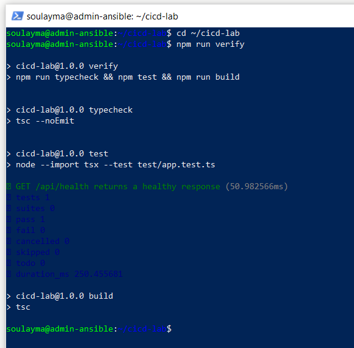

### 1. First Render deployment and `/api/health`
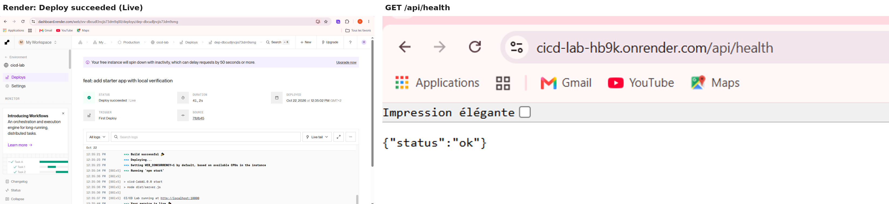

### 2. Verify job passing in GitHub Actions
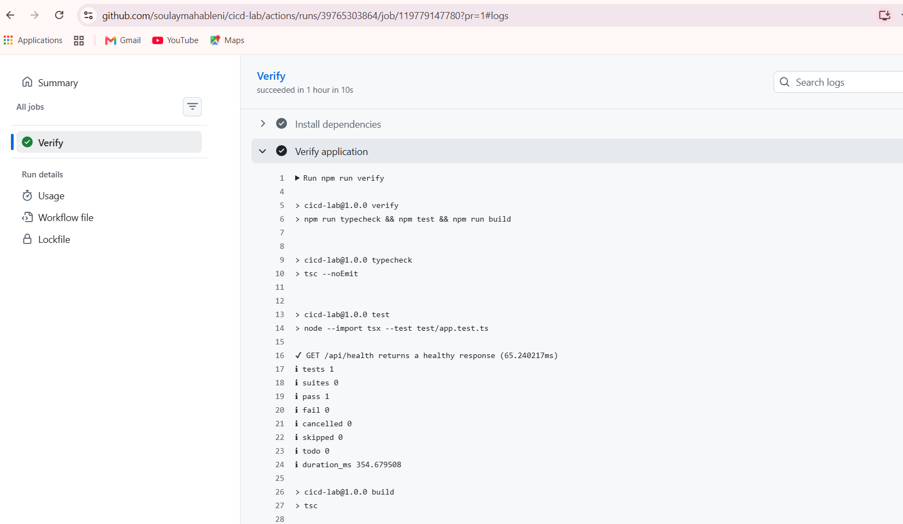

Workflow runs for the pull request and for `main` after the merge:

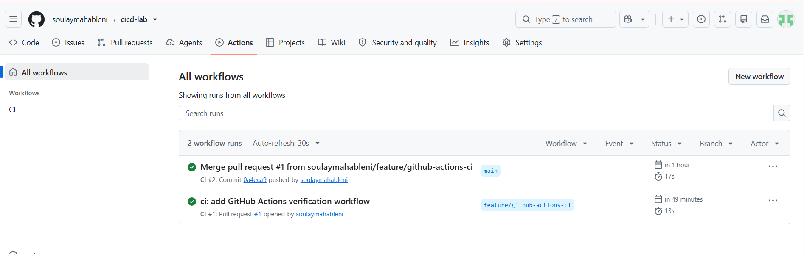

### 3. Render Auto-Deploy: After CI Checks Pass
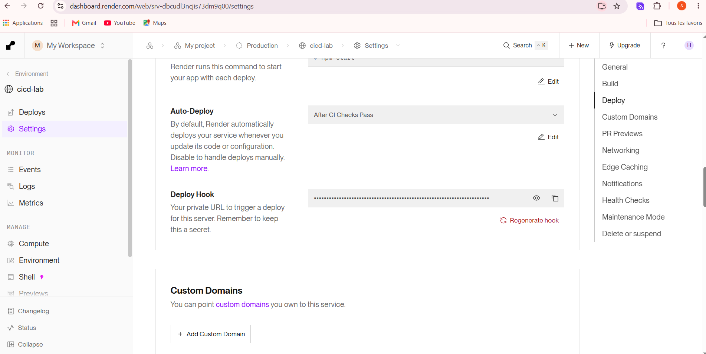

### 4. Ruleset "Protect main" requiring Verify
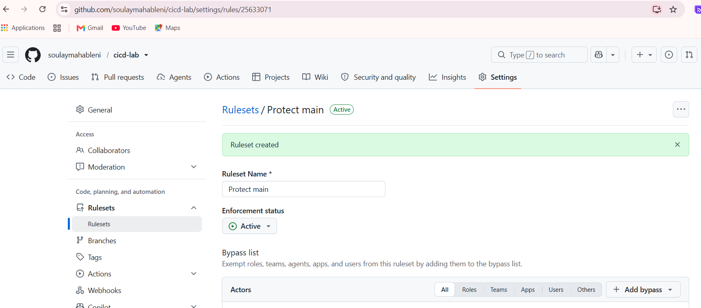

### 5. Home page updated through the pipeline
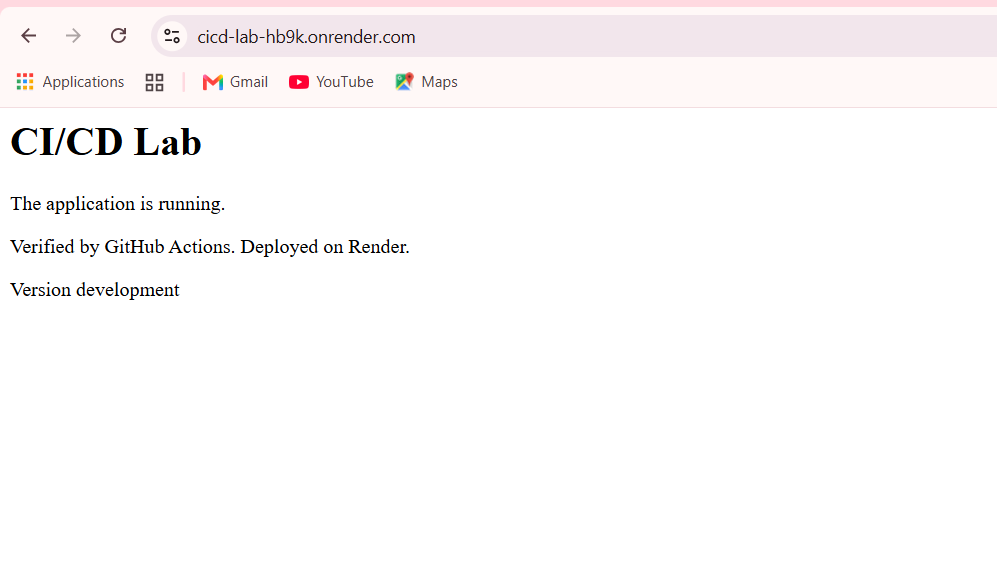

### 6. Failing Verify blocks the merge
The test for `/api/version` was pushed before the route existed (404 instead of 200):

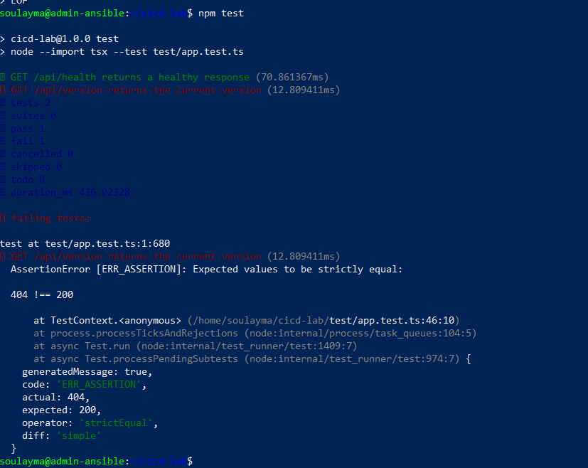

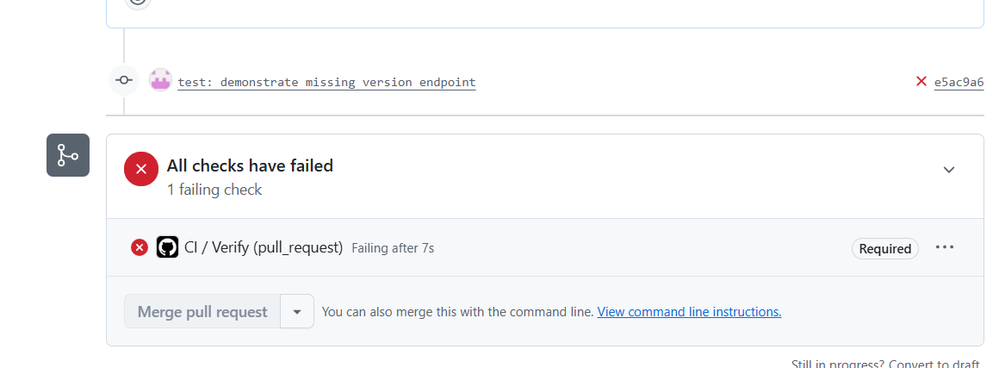

After adding the route to the same branch, the pull request turned green:

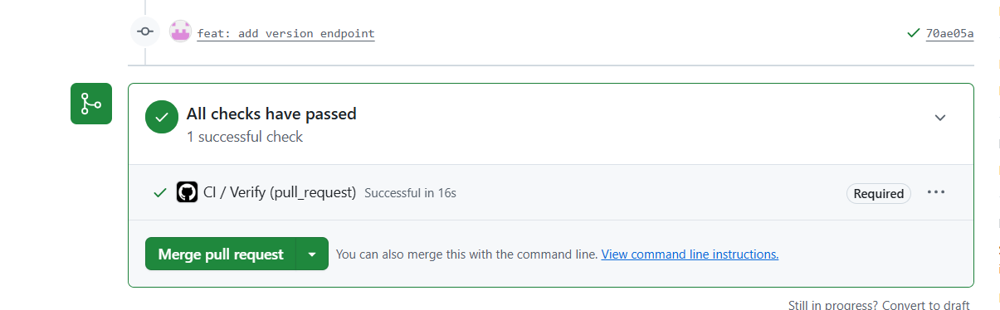

### 7. `/api/version` after deployment
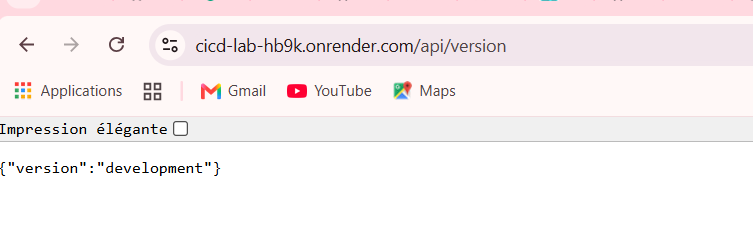

### 8. Preview vs production
Pull Request Previews set to Automatic in Render:

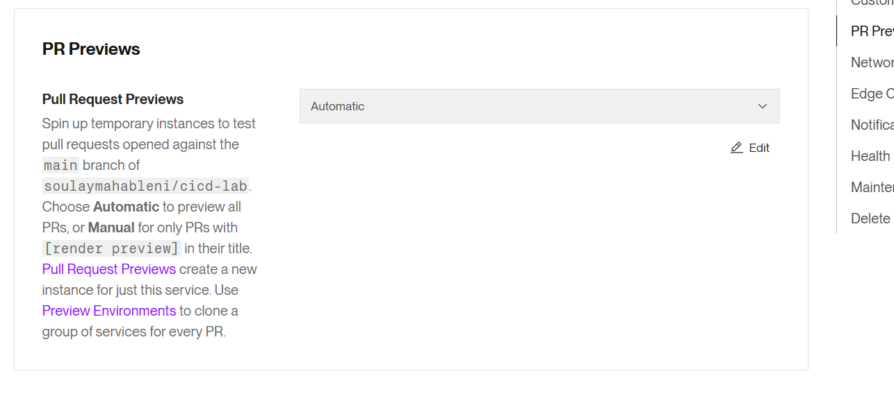

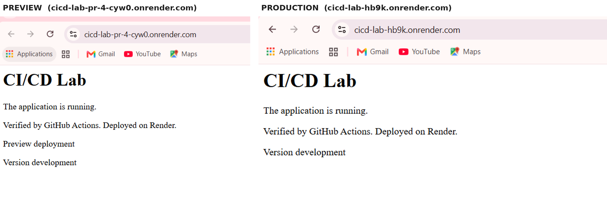

## Report

See [REPORT.md](REPORT.md).
